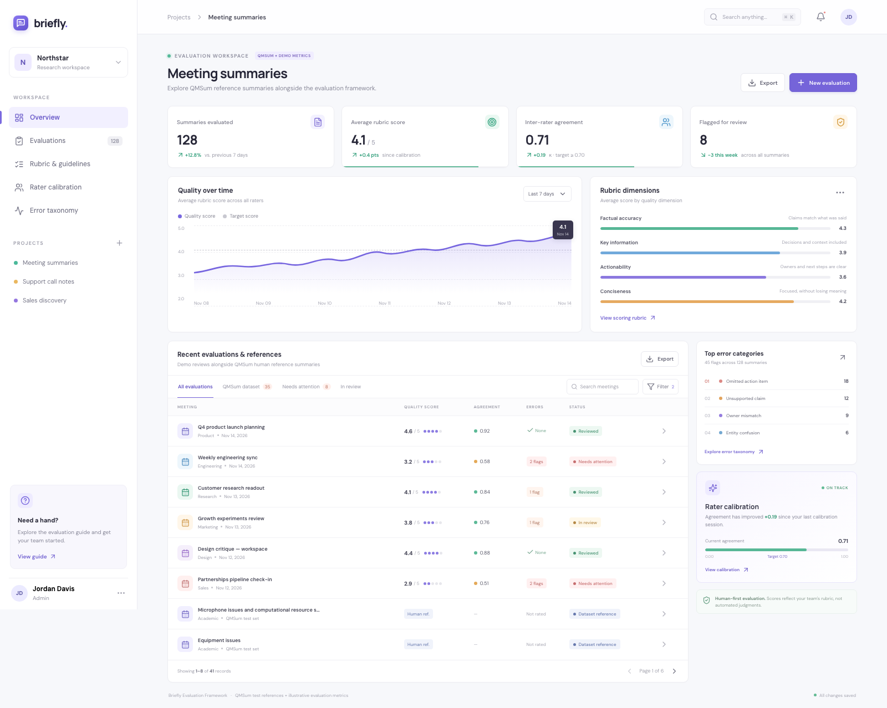
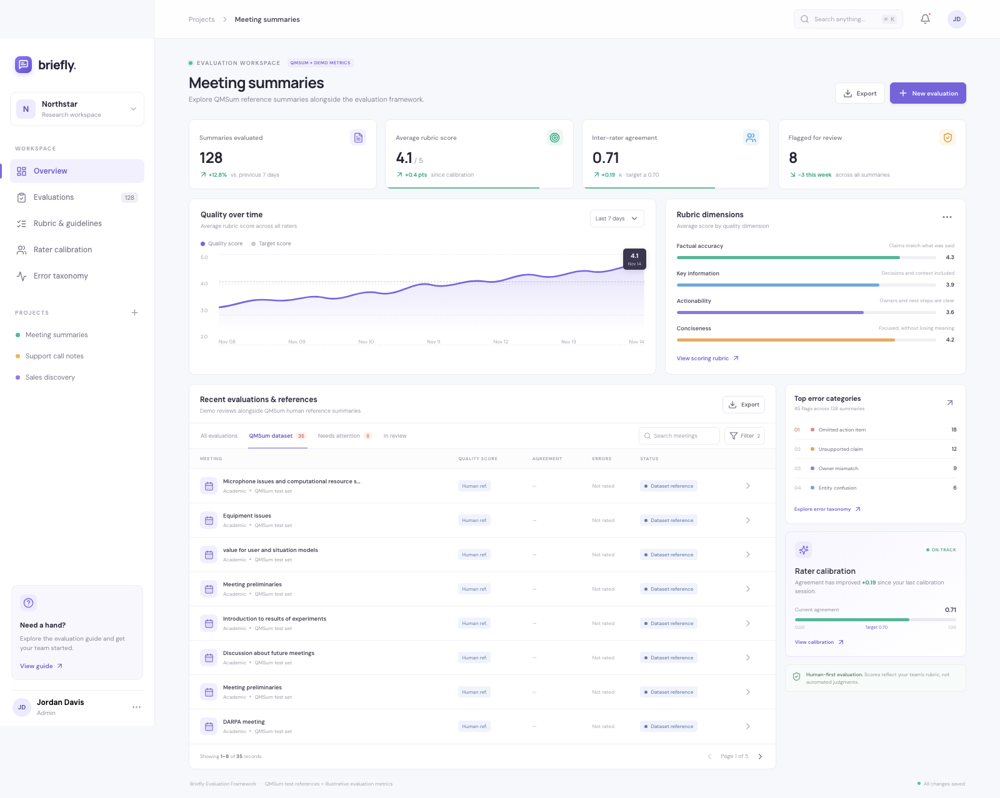
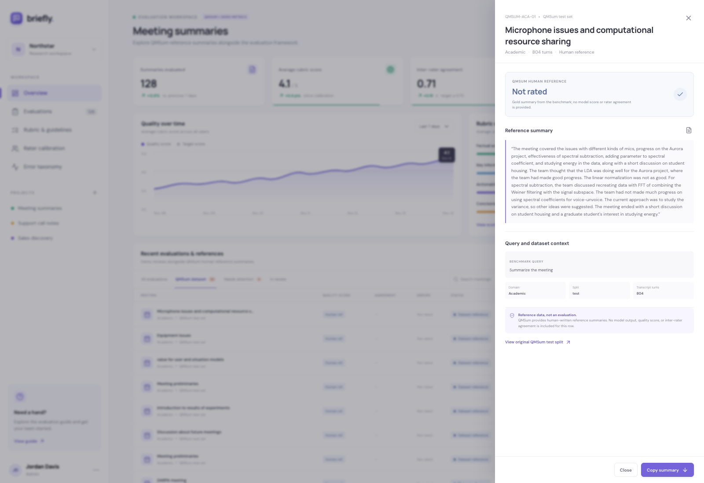

# Meeting Summarization Quality & Human Evaluation Framework

A practical framework and interactive dashboard for evaluating meeting summaries with human raters. It brings rubric-based quality scoring, rater calibration, and a consistent error taxonomy into one review workflow.

## Why this project

Fluent summaries can still miss a decision, invent a commitment, or assign an action to the wrong person. This framework helps reviewers identify those errors consistently and turn their findings into concrete quality improvements.

The project brief reports:

- **Inter-rater agreement improved from 0.52 to 0.71** after introducing structured rubrics and calibration.
- **Rubric scores increased by 0.4 points** after using error patterns to guide improvements.

The interface combines illustrative evaluation records and metrics with real reference summaries from QMSum. Illustrative metrics are examples, not outputs calculated from QMSum or independent verification of the reported results.

## Evaluation rubric

Reviewers score each dimension from 1 to 5 and attach an error label when appropriate.

| Dimension | Review question |
| --- | --- |
| Factual accuracy | Are claims supported by the meeting transcript? |
| Key information | Are important decisions, context, and caveats included? |
| Actionability | Are next steps, owners, and timelines clear and correct? |
| Conciseness | Is the summary focused without losing important meaning? |

Rater calibration uses shared examples to align interpretations of the rubric. Reviewers then score independently and discuss disagreements, helping reveal ambiguous criteria and recurring model errors.

## Error taxonomy

- **Omitted action item** — a stated next step, owner, or deadline is missing.
- **Unsupported claim** — the summary adds a claim or certainty not supported by the source.
- **Owner mismatch** — an action is assigned to the wrong person or team.
- **Entity confusion** — people, teams, products, or other named entities are mixed up.
- **Decision invented** — a proposal or open question is presented as an agreed decision.
- **Minor detail** — a low-impact nuance or supporting detail is missing or imprecise.

## Dashboard

The responsive dashboard includes:

- Quality score trends, rubric dimension breakdowns, and an agreement calibration target.
- A searchable, filterable, paginated evaluation table with review statuses and error flags.
- Detail views for summaries, rubric scores, agreement, benchmark queries, and reference text.
- A queue form for adding a meeting evaluation and CSV export of filtered records.
- An error-category breakdown to make recurring issues easier to inspect.

## Screenshots

### Evaluation dashboard



### QMSum reference browser

<table>
  <tr>
    <td></td>
    <td></td>
  </tr>
  <tr>
    <td align="center">Browse the 35 reference summaries</td>
    <td align="center">Inspect a query and reference</td>
  </tr>
</table>

### QMSum examples

The dashboard includes **35 human reference summaries** from the official QMSum test splits: 9 Academic, 20 Product, and 6 Committee examples. QMSum contains 1,808 query-summary pairs over 232 meetings.

Select **QMSum dataset** to browse the examples. Each record links its reference summary to the benchmark query, domain, and transcript-turn count. These are human-written references—not generated summaries—and they have no model scores or inter-rater agreement attached. Dataset attribution and license details are in [`NOTICE`](./NOTICE).

The curated examples live in [`src/qmsum-samples.json`](./src/qmsum-samples.json). Regenerate them from the official test splits with:

```bash
python3 scripts/import_qmsum.py
```

## Run locally

Requires Node.js 20+ and npm.

```bash
npm install
npm run dev
```

Create and preview a production build:

```bash
npm run build
npm run preview
```

New evaluations are held in browser memory and reset on refresh. The prototype does not require an account or backend.

## Technology

React · TypeScript · Vite · Lucide
